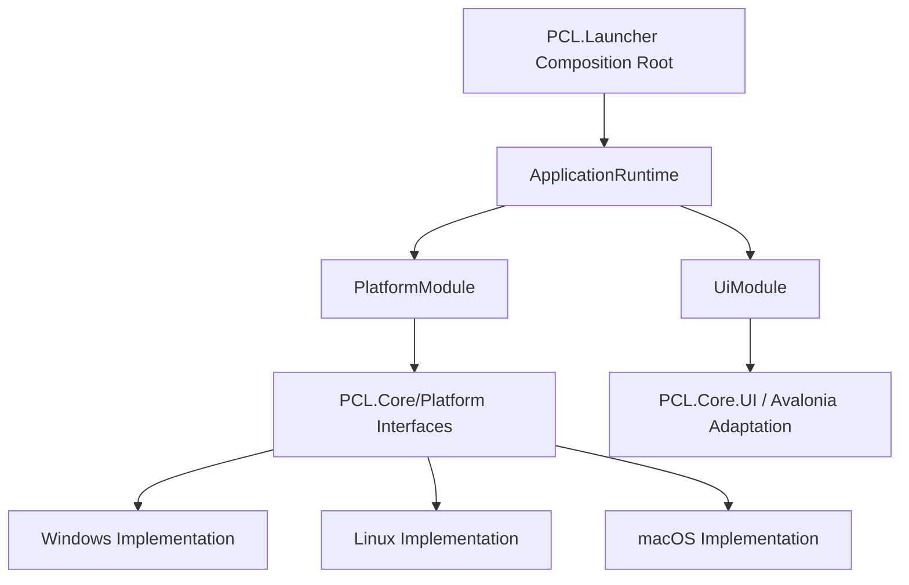

# Cross-Platform Abstraction

This article describes how PCL CE isolates operating-system-specific behavior, how platform services are registered, and how application code accesses those services.

PCL CE supports Windows, Linux, and macOS. Business code should depend on platform interfaces rather than detect the current operating system or instantiate platform implementations directly. Platform contracts are defined in `PCL.Core/Platform`; operating-system services are implemented in `PCL.Platform`; Avalonia-specific UI services are implemented in `PCL.Core.UI`.

## Overview

The cross-platform abstraction consists of the following layers:

| Layer               | Responsibility                                                                                    |
|---------------------|---------------------------------------------------------------------------------------------------|
| `PCL.Core/Platform` | Defines platform service interfaces, capability flags, platform detection, and runtime facades    |
| `PCL.Platform`      | Implements operating-system services for Windows, Linux, macOS, and shared POSIX behavior         |
| `PCL.Core.UI`       | Adapts Avalonia services, including UI dispatching, clipboard, dialogs, theming, and localization |
| `PCL.Launcher`      | Acts as the composition root and handles platform selection and startup differences               |

The main dependency relationship is:



The design follows these principles:

* Business code depends on interfaces, not concrete platform implementations
* Platform selection is performed at the composition root and in the platform startup layer
* Use capability flags for differences that can be expressed as simple feature switches
* Provide an explicit fallback when a platform does not support a capability

## Core Types

### `PlatformKind`

`PlatformKind` identifies the current platform:

| Value     | Description |
|-----------|-------------|
| `Windows` | Windows     |
| `Linux`   | Linux       |
| `MacOs`   | macOS       |

Use the enum for display, logging, platform resolution, and composition-root selection. Feature logic should prefer service interfaces and capability flags instead of branching directly on `PlatformKind`.

### `PlatformDetector`

`PlatformDetector.Detect` is the runtime platform detection entry point:

```cs
var kind = PlatformDetector.Detect();
```

The method returns the corresponding `PlatformKind`. It throws `PlatformNotSupportedException` when the operating system is not supported.

### `IPlatformCapabilities`

`IPlatformCapabilities` describes the capabilities available on the current platform. Each platform module supplies an explicit capability set; shared code should not infer capabilities from the operating system.

`PlatformCapabilities` provides predefined instances for Windows, Linux, and macOS.

### `PlatformModule`

`PlatformModule` is the facade for commonly used platform services:

| Property            | Service                     |
|---------------------|-----------------------------|
| `SystemProxy`       | `ISystemProxyProvider`      |
| `WindowInterop`     | `IWindowInterop`            |
| `Shortcuts`         | `IShortcutService`          |
| `Java`              | `IJavaPlatformInfo`         |
| `ProcessCleanup`    | `IProcessCleanupService`    |
| `GpuPreference`     | `IGpuPreferenceService`     |
| `LaunchEnvironment` | `ILaunchEnvironmentService` |
| `SystemFacts`       | `ISystemFacts`              |
| `Hardware`          | `IHardwareInfo`             |
| `Shell`             | `IShellLauncher`            |
| `Region`            | `IRegionSignalProvider`     |
| `RecycleBin`        | `IRecycleBinService`        |
| `FatalDialog`       | `IFatalDialogService`       |

`PlatformModule.Kind` identifies the current platform, and `Capabilities` returns its capability set. The module also provides `CreateKeyProtector(byte[] key)`, which delegates to `IKeyProtectorFactory`.

Not every registered service is exposed as a `PlatformModule` property. Other services can be resolved through `ApplicationRuntime.GetRequiredService<T>()`.

### `UiModule`

`UiModule` is the facade for UI services:

| Property        | Service                      |
|-----------------|------------------------------|
| `Dispatcher`    | `IUiDispatcher`              |
| `Clipboard`     | `IClipboardService`          |
| `FileDialogs`   | `IFileDialogService`         |
| `ResourceStore` | `IResourceStore`             |
| `Localization`  | `ILocalizationBackend`       |
| `Theme`         | `IThemeBackend`              |
| `SystemTheme`   | `ISystemThemeProvider`       |
| `Notifications` | `ISystemNotificationService` |

### `ApplicationRuntime`

`ApplicationRuntime` is the application's runtime service entry point. The application initializes it during startup before resolving services.

| Member                            | Description                                                                                           |
|-----------------------------------|-------------------------------------------------------------------------------------------------------|
| `Current`                         | Returns the current `ApplicationServices`; throws if the runtime is not initialized                   |
| `IsInitialized`                   | Indicates whether the runtime has been initialized                                                    |
| `GetService<T>()`                 | Resolves a service; returns `null` if the runtime is not initialized or the service is not registered |
| `GetRequiredService<T>()`         | Resolves a required service; throws `InvalidOperationException` if it is unavailable                  |
| `Initialize(ApplicationServices)` | Sets the current runtime; throws if a runtime is already initialized                                  |
| `Shutdown()`                      | Idempotently disposes the UI facade, platform facade, and service provider                            |

`ApplicationServices` contains the `Platform` and `Ui` facades, together with an optional `IServiceProvider` used to resolve registered services.

## Platform Capabilities

Platform capabilities are exposed through `IPlatformCapabilities`. The predefined values are:

| Capability                         | Description                                                          | Windows | Linux                   | macOS                   |
|------------------------------------|----------------------------------------------------------------------|---------|-------------------------|-------------------------|
| `SupportsBundledLauncher`          | Whether a modpack can include the launcher                           | `true`  | `false`                 | `false`                 |
| `SupportsShortcutIcon`             | Whether shortcuts support custom icons                               | `false` | `true`                  | `false`                 |
| `NativeLibraryExtensions`          | File extensions used to identify native libraries                    | `.dll`  | `.dll`, `.so`, `.dylib` | `.dll`, `.so`, `.dylib` |
| `SupportsWindowsStoreDependencies` | Whether Microsoft Store dependencies are checked                     | `true`  | `false`                 | `false`                 |
| `SuppressAltMenu`                  | Whether the Alt key is intercepted to suppress the system menu       | `true`  | `false`                 | `false`                 |
| `SupportsDisplayProtocolSelection` | Whether the display protocol can be selected, such as X11 or Wayland | `false` | `true`                  | `false`                 |

Use capability flags for simple behavior switches. If a capability requires a different operation flow or platform API, define a platform service interface instead.

## Platform Services

Platform service interfaces are defined in `PCL.Core/Platform`. Their operating-system implementations are located in `PCL.Platform`.

### System and Processes

| Interface                    | Description                                                 | Windows                            | Linux                             | macOS                            |
|------------------------------|-------------------------------------------------------------|------------------------------------|-----------------------------------|----------------------------------|
| `IExternalCommandRunner`     | Runs external commands and reads their output               | `ExternalCommandRunner`            | `ExternalCommandRunner`           | `ExternalCommandRunner`          |
| `IElevationService`          | Checks elevation and starts elevated processes              | `PlatformElevationService`         | `PlatformElevationService`        | `PlatformElevationService`       |
| `IProcessLauncher`           | Starts ordinary processes                                   | `PlatformProcessLauncher`          | `PlatformProcessLauncher`         | `PlatformProcessLauncher`        |
| `ISystemProxyProvider`       | Reads system proxy settings                                 | `WindowsSystemProxyProvider`       | `LinuxSystemProxyProvider`        | `MacOsSystemProxyProvider`       |
| `IWindowInterop`             | Finds and controls game windows                             | `WindowsWindowInterop`             | `LinuxWindowInterop`              | `MacOsWindowInterop`             |
| `IShortcutService`           | Creates shortcuts                                           | `WindowsShortcutService`           | `LinuxShortcutService`            | `MacOsShortcutService`           |
| `IProcessCleanupService`     | Cleans up additional data and removes folders after restart | `WindowsProcessCleanupService`     | `PosixProcessCleanupService`      | `PosixProcessCleanupService`     |
| `ISystemFacts`               | Queries administrator status and memory information         | `WindowsSystemFacts`               | `LinuxSystemFacts`                | `MacOsSystemFacts`               |
| `IHardwareInfo`              | Collects CPU and GPU information                            | `WindowsHardwareInfo`              | `LinuxHardwareInfo`               | `MacOsHardwareInfo`              |
| `IShellLauncher`             | Opens paths and URLs                                        | `WindowsShellLauncher`             | `PosixShellLauncher` (`xdg-open`) | `PosixShellLauncher` (`open`)    |
| `IShellCommandService`       | Builds shell command startup arguments                      | `WindowsShellCommandService`       | `PosixShellCommandService`        | `PosixShellCommandService`       |
| `IProcessEnvironmentService` | Handles platform-specific process environment variables     | `WindowsProcessEnvironmentService` | `PosixProcessEnvironmentService`  | `PosixProcessEnvironmentService` |
| `IRegionSignalProvider`      | Reads signals used for region detection                     | `WindowsRegionSignalProvider`      | `PosixRegionSignalProvider`       | `PosixRegionSignalProvider`      |
| `IRecycleBinService`         | Moves files to the recycle bin                              | `WindowsRecycleBinService`         | `LinuxRecycleBinService`          | `MacOsRecycleBinService`         |
| `IFatalDialogService`        | Shows a fatal error dialog before the UI is ready           | `WindowsFatalDialogService`        | `LinuxFatalDialogService`         | `MacOsFatalDialogService`        |
| `IKeyProtectorFactory`       | Creates a local-user key protector                          | `WindowsKeyProtectorFactory`       | `UnixKeyProtectorFactory`         | `UnixKeyProtectorFactory`        |
| `IPlatformPathService`       | Handles platform-specific path semantics                    | `WindowsPlatformPathService`       | `LinuxPlatformPathService`        | `MacOsPlatformPathService`       |

### Games and Java

| Interface                    | Description                                              | Windows                               | Linux                                    | macOS                                         |
|------------------------------|----------------------------------------------------------|---------------------------------------|------------------------------------------|-----------------------------------------------|
| `IJavaPlatformInfo`          | Provides Java executable names, parsers, and scanners    | `WindowsJavaPlatformInfo`             | `LinuxJavaPlatformInfo`                  | `MacOsJavaPlatformInfo`                       |
| `IMinecraftPlatformRules`    | Handles Minecraft version rules and native library names | `WindowsMinecraftPlatformRules`       | `LinuxMinecraftPlatformRules`            | `MacOsMinecraftPlatformRules`                 |
| `IGpuPreferenceService`      | Requests that the game use a dedicated GPU               | `WindowsGpuPreferenceService`         | `UnsupportedGpuPreferenceService`        | `UnsupportedGpuPreferenceService`             |
| `ILaunchEnvironmentService`  | Prepares environment variables for the game process      | `UnsupportedLaunchEnvironmentService` | `LinuxLaunchEnvironmentService`          | `UnsupportedLaunchEnvironmentService`         |
| `ILaunchScriptService`       | Generates client launch scripts                          | `WindowsLaunchScriptService`          | `PosixLaunchScriptService`               | `PosixLaunchScriptService`                    |
| `IServerLaunchScriptService` | Generates server launch scripts                          | `WindowsServerLaunchScriptService`    | `PosixServerLaunchScriptService` (`.sh`) | `PosixServerLaunchScriptService` (`.command`) |
| `IRuntimeEnvironmentService` | Checks for launcher runtime environment issues           | `WindowsRuntimeEnvironmentService`    | `LinuxRuntimeEnvironmentService`         | `MacOsRuntimeEnvironmentService`              |

### UI Adaptation

UI service interfaces are defined in `PCL.Core/Platform`, and their Avalonia implementations are provided by `PCL.Core.UI`.

| Interface                    | Description                                   | Windows                      | Linux                      | macOS                      |
|------------------------------|-----------------------------------------------|------------------------------|----------------------------|----------------------------|
| `IUiDispatcher`              | Accesses and dispatches work to the UI thread | `AvaloniaUiDispatcher`       | `AvaloniaUiDispatcher`     | `AvaloniaUiDispatcher`     |
| `IClipboardService`          | Provides clipboard access                     | `ClipboardService`           | `ClipboardService`         | `ClipboardService`         |
| `IFileDialogService`         | Shows file and folder dialogs                 | `FileDialogService`          | `LinuxFileDialogService`   | `FileDialogService`        |
| `IResourceStore`             | Provides access to packaged resources         | `ResourceStore`              | `ResourceStore`            | `ResourceStore`            |
| `ILocalizationBackend`       | Loads and looks up localization resources     | `LocalizationBackend`        | `LocalizationBackend`      | `LocalizationBackend`      |
| `IThemeBackend`              | Applies theme resources                       | `ThemeBackend`               | `ThemeBackend`             | `ThemeBackend`             |
| `ISystemThemeProvider`       | Detects the system light or dark theme        | `SystemThemeProvider`        | `LinuxSystemThemeProvider` | `SystemThemeProvider`      |
| `ISystemNotificationService` | Sends system notifications                    | `WindowsNotificationService` | `LinuxNotificationService` | `MacOsNotificationService` |
| `IApplicationHost`           | Abstracts the application container           | `ApplicationHost`            | `ApplicationHost`          | `ApplicationHost`          |
| `IWindowHost`                | Abstracts the main window                     | `WindowHost`                 | `WindowHost`               | `WindowHost`               |

The launcher also registers several UI-related services directly, including `IUpdatePolicy`, `IPlatformFontProvider`, and `ITaskbarProgressBackend`. These are launcher-level services rather than part of the general `PCL.Core/Platform` contract, and their implementations are selected by the launcher composition root.

## Service Registration and Startup

Platform and UI services are registered with the dependency injection container:

```cs
services.AddPlatformServices(kind);
services.AddAvaloniaUi(kind);
```

`PlatformServiceRegistration.AddPlatformServices` registers operating-system services according to `PlatformKind`. `AvaloniaUiServiceRegistration.AddAvaloniaUi` registers UI services and selects the file dialog, system theme, and system notification implementations for the current platform.

The launcher composition root performs the remaining setup. `PlatformRegistration.Register` creates the facades through `PlatformModuleFactory` and `UiModuleFactory`, then initializes `ApplicationRuntime`. `LauncherServiceRegistration.Build` then registers platform, UI, and launcher services, builds the service provider, and assigns it to `ApplicationServices.Services`.

The startup sequence in `PCL.Launcher` is represented by:

```cs
var kind = PlatformDetector.Detect();
PlatformStartup.Initialize(kind, args);
var applicationServices = PlatformRegistration.Register(kind);
var serviceProvider = LauncherServiceRegistration.Build(applicationServices);
```

### Platform Startup Differences

`PlatformStartup` selects the platform-specific startup implementation and configures Avalonia before the application is initialized.

| Platform | Startup Behavior                                                                                                                                                                                                                                                                                                                                                                        |
|----------|-----------------------------------------------------------------------------------------------------------------------------------------------------------------------------------------------------------------------------------------------------------------------------------------------------------------------------------------------------------------------------------------|
| Windows  | Handles the `--console` argument and configures Avalonia platform detection and the Inter font                                                                                                                                                                                                                                                                                          |
| Linux    | Uses `Config.Debug.LinuxProtocol` (`0` = `Auto`, `1` = `X11`, `2` = `Wayland`). Auto mode follows the desktop session and falls back to X11 when detection is inconclusive. `PCL_USE_WAYLAND=1` forces Wayland; `PCL_FORCE_X11` takes precedence and forces X11. When Wayland is selected, the launcher ensures the desktop entry exists and enables the Wayland backend with fallback. |
| macOS    | Uses `MacOSPlatformOptions` to show the app in the Dock and disable native menus; the Dock icon is set after framework initialization                                                                                                                                                                                                                                                   |

The platform startup layer also invokes `IPlatformShellIntegration` after framework initialization and window creation. This interface and its implementations are internal to `PCL.Launcher`, not public APIs.

## Implementing New Platform Capabilities

When adding a platform capability, follow this order:

1. Define a platform-independent interface in `PCL.Core/Platform` and document its behavior contract
2. Implement the interface in `PCL.Platform/Windows`, `Linux`, `MacOS`, or a shared directory
3. Register the implementation for each supported platform in `PlatformServiceRegistration`
4. If the service should be exposed through `PlatformModule`, add a corresponding facade property
5. If the requirement is only a simple behavior switch, extend `IPlatformCapabilities` instead

Interface example:

```cs
namespace PCL.Core.Platform;

public interface IMyPlatformService
{
    bool IsSupported { get; }

    void DoSomething(string value);
}
```

Platform implementation example:

```cs
namespace PCL.Platform;

public sealed class WindowsMyPlatformService : IMyPlatformService
{
    public bool IsSupported => true;

    public void DoSomething(string value)
    {
        // Windows implementation
    }
}
```

When a platform does not support the capability, provide an explicit fallback implementation. Callers should check `IsSupported` before invoking the operation:

```cs
public sealed class UnsupportedMyPlatformService : IMyPlatformService
{
    public bool IsSupported => false;

    public void DoSomething(string value)
    {
    }
}
```

Registration example:

```cs
services.AddSingleton<IMyPlatformService>(_ => kind switch
{
    PlatformKind.Windows => new WindowsMyPlatformService(),
    PlatformKind.Linux or PlatformKind.MacOs => new UnsupportedMyPlatformService(),
    _ => throw new PlatformNotSupportedException($"Platform {kind} is not supported.")
});
```

Platform implementations should reuse the shared base classes and helpers in `PCL.Platform/Shared` and `PCL.Platform/Posix` where possible. Keep platform-specific interop in the corresponding implementation layer; shared low-level operating-system helpers belong in `PCL.Core/Utils/OS`. Prefer `LibraryImport` for new declarations where it is supported by the API and project setup.

`PCL.Core` should remain independent of Avalonia. UI framework-specific implementations belong in `PCL.Core.UI`, and platform implementations should not depend on launcher pages or view models.

## Using Platform Services in Business Code

Business code should obtain platform services through constructor injection or `ApplicationRuntime`:

```cs
public sealed class SomeService(IPlatformPathService paths)
{
    public string GetMinecraftDirectory()
    {
        return paths.GetOfficialMinecraftDirectory();
    }
}
```

A service can also be resolved directly:

```cs
var paths = ApplicationRuntime.GetRequiredService<IPlatformPathService>();
```

To access the platform facade and its capabilities:

```cs
var platform = ApplicationRuntime.Current.Platform;
var capabilities = platform.Capabilities;
```

Avoid branching in business logic on operating-system checks such as:

```cs
if (OperatingSystem.IsWindows())
{
    // ...
}
```

Express platform differences through service interfaces or capability flags instead. Adding a platform should then require new implementations and registrations, rather than changes to business logic.

## API Summary

### Core Types

| API                     | Description                             |
|-------------------------|-----------------------------------------|
| `PlatformKind`          | Current platform                        |
| `PlatformDetector`      | Runtime platform detection entry point  |
| `IPlatformCapabilities` | Platform capability interface           |
| `PlatformCapabilities`  | Predefined platform capability sets     |
| `PlatformModule`        | Platform service facade                 |
| `UiModule`              | UI service facade                       |
| `ApplicationRuntime`    | Application runtime service entry point |
| `ApplicationServices`   | Application runtime service bundle      |

### Frequently Used Platform Services

| API                          | Description                        |
|------------------------------|------------------------------------|
| `IPlatformPathService`       | Platform path operations           |
| `IProcessLauncher`           | Ordinary process launch            |
| `IExternalCommandRunner`     | External command execution         |
| `IWindowInterop`             | Game window interaction            |
| `IShellLauncher`             | Opens paths and URLs               |
| `IJavaPlatformInfo`          | Java platform information          |
| `IMinecraftPlatformRules`    | Minecraft platform rules           |
| `ILaunchScriptService`       | Client launch scripts              |
| `IServerLaunchScriptService` | Server launch scripts              |
| `IGpuPreferenceService`      | GPU preference                     |
| `ILaunchEnvironmentService`  | Game process environment variables |
| `IRuntimeEnvironmentService` | Runtime environment checks         |
| `IRecycleBinService`         | Recycle bin operations             |
| `IFatalDialogService`        | Fatal error dialog                 |
| `IKeyProtectorFactory`       | Local-user key protector creation  |

### UI Contracts

| API                          | Description                       |
|------------------------------|-----------------------------------|
| `IUiDispatcher`              | UI thread dispatching             |
| `IApplicationHost`           | Application container abstraction |
| `IWindowHost`                | Main window abstraction           |
| `IClipboardService`          | Clipboard access                  |
| `IFileDialogService`         | File and folder dialogs           |
| `ISystemNotificationService` | System notifications              |
| `ISystemThemeProvider`       | System theme detection            |
| `IThemeBackend`              | Theme resource application        |
| `ILocalizationBackend`       | Localization resource loading     |
| `IResourceStore`             | Packaged resource access          |

## Usage Recommendations

* Define platform-independent interfaces before adding platform-specific implementations
* Avoid branching on `PlatformKind` in feature logic; use service interfaces and capability flags instead
* Keep platform selection and service registration in the composition root
* Use `IPlatformCapabilities` for simple feature switches, and service interfaces for platform-specific operations
* Provide explicit fallback behavior when a platform does not support a capability
* Reuse shared logic in `PCL.Platform/Shared` and `PCL.Platform/Posix` where possible
* Keep Avalonia-specific code in `PCL.Core.UI` and keep `PCL.Core` independent of Avalonia
* Keep platform-specific interop in the implementation layer and use `LibraryImport` for new declarations where appropriate
* Build and perform basic functional verification on the target platform after changing platform services
