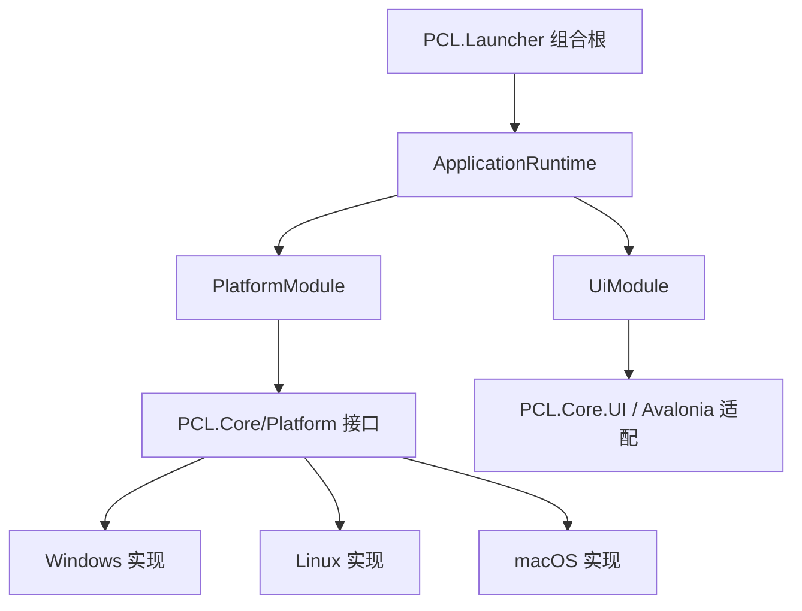

# 跨平台抽象

本文介绍 PCL CE 如何隔离操作系统差异、注册平台服务，以及业务代码如何访问这些服务。

PCL CE 支持 Windows、Linux 与 macOS。业务代码应依赖平台接口，而不是直接判断当前操作系统或创建具体平台实现。平台契约定义在 `PCL.Core/Platform` 中，操作系统服务由 `PCL.Platform` 实现，Avalonia 相关 UI 服务由 `PCL.Core.UI` 实现。

## 概览

跨平台抽象主要由以下层次组成：

| 层次                | 职责                                                              |
|---------------------|-------------------------------------------------------------------|
| `PCL.Core/Platform` | 定义平台服务接口、能力标志、平台识别入口与运行时门面              |
| `PCL.Platform`      | 实现 Windows、Linux、macOS 及共享 POSIX 平台服务                  |
| `PCL.Core.UI`       | 适配 Avalonia UI 服务，包括线程调度、剪贴板、对话框、主题与本地化 |
| `PCL.Launcher`      | 作为组合根，负责平台选择与启动差异处理                            |

主要依赖关系如下：



设计上遵循以下原则：

* 业务代码依赖接口，不依赖具体平台实现
* 平台选择集中在组合根与平台启动层
* 能通过能力标志表达的简单差异，应使用能力标志处理
* 当前平台不支持某项能力时，应提供明确的降级实现

## 核心类型

### `PlatformKind`

`PlatformKind` 表示当前运行平台：

| 值        | 说明    |
|-----------|---------|
| `Windows` | Windows |
| `Linux`   | Linux   |
| `MacOs`   | macOS   |

该枚举用于显示、日志、平台解析和组合根选择。功能逻辑应优先依赖服务接口与能力标志，而不是直接按 `PlatformKind` 分支。

### `PlatformDetector`

`PlatformDetector.Detect` 是运行时识别平台的统一入口：

```cs
var kind = PlatformDetector.Detect();
```

该方法返回对应的 `PlatformKind`。当前操作系统不受支持时，会抛出 `PlatformNotSupportedException`。

### `IPlatformCapabilities`

`IPlatformCapabilities` 描述当前平台支持的能力。每个平台模块都必须显式提供能力集合，共享代码不应根据操作系统自行推断。

`PlatformCapabilities` 提供 Windows、Linux 与 macOS 的预定义实例。

### `PlatformModule`

`PlatformModule` 是常用平台服务的访问门面：

| 属性                | 对应服务                    |
|---------------------|-----------------------------|
| `SystemProxy`       | `ISystemProxyProvider`      |
| `WindowInterop`     | `IWindowInterop`            |
| `Shortcuts`         | `IShortcutService`          |
| `Java`              | `IJavaPlatformInfo`         |
| `ProcessCleanup`    | `IProcessCleanupService`    |
| `GpuPreference`     | `IGpuPreferenceService`     |
| `LaunchEnvironment` | `ILaunchEnvironmentService` |
| `SystemFacts`       | `ISystemFacts`              |
| `Hardware`          | `IHardwareInfo`             |
| `Shell`             | `IShellLauncher`            |
| `Region`            | `IRegionSignalProvider`     |
| `RecycleBin`        | `IRecycleBinService`        |
| `FatalDialog`       | `IFatalDialogService`       |

`PlatformModule.Kind` 表示当前平台，`Capabilities` 返回对应的能力集合。此外，模块还提供 `CreateKeyProtector(byte[] key)`，由 `IKeyProtectorFactory` 创建密钥保护器。

并非所有已注册服务都会作为 `PlatformModule` 属性公开。其他服务可以通过 `ApplicationRuntime.GetRequiredService<T>()` 解析。

### `UiModule`

`UiModule` 是 UI 服务的访问门面：

| 属性            | 对应服务                     |
|-----------------|------------------------------|
| `Dispatcher`    | `IUiDispatcher`              |
| `Clipboard`     | `IClipboardService`          |
| `FileDialogs`   | `IFileDialogService`         |
| `ResourceStore` | `IResourceStore`             |
| `Localization`  | `ILocalizationBackend`       |
| `Theme`         | `IThemeBackend`              |
| `SystemTheme`   | `ISystemThemeProvider`       |
| `Notifications` | `ISystemNotificationService` |

### `ApplicationRuntime`

`ApplicationRuntime` 是应用运行时的统一服务入口，应用会在启动期间完成初始化，然后再解析服务。

| 成员                              | 说明                                                       |
|-----------------------------------|------------------------------------------------------------|
| `Current`                         | 返回当前 `ApplicationServices`；运行时未初始化时抛出异常   |
| `IsInitialized`                   | 判断运行时是否已初始化                                     |
| `GetService<T>()`                 | 解析服务；运行时未初始化或服务未注册时返回 `null`          |
| `GetRequiredService<T>()`         | 解析必需服务；服务不可用时抛出 `InvalidOperationException` |
| `Initialize(ApplicationServices)` | 设置当前运行时；已有运行时时会抛出异常                     |
| `Shutdown()`                      | 幂等释放 UI 门面、平台门面与服务容器                       |

`ApplicationServices` 包含 `Platform`、`Ui` 两个门面，以及用于解析已注册服务的可选 `IServiceProvider`。

## 平台能力

平台能力通过 `IPlatformCapabilities` 暴露。各平台的预定义值如下：

| 能力                               | 说明                                      | Windows | Linux                   | macOS                   |
|------------------------------------|-------------------------------------------|---------|-------------------------|-------------------------|
| `SupportsBundledLauncher`          | 是否允许在整合包中附带启动器              | `true`  | `false`                 | `false`                 |
| `SupportsShortcutIcon`             | 快捷方式是否支持自定义图标                | `false` | `true`                  | `false`                 |
| `NativeLibraryExtensions`          | 用于识别原生库的文件扩展名                | `.dll`  | `.dll`、`.so`、`.dylib` | `.dll`、`.so`、`.dylib` |
| `SupportsWindowsStoreDependencies` | 是否检查 Microsoft Store 依赖             | `true`  | `false`                 | `false`                 |
| `SuppressAltMenu`                  | 是否拦截 Alt 键以抑制系统菜单             | `true`  | `false`                 | `false`                 |
| `SupportsDisplayProtocolSelection` | 是否支持选择显示协议，例如 X11 或 Wayland | `false` | `true`                  | `false`                 |

简单的行为开关应通过能力标志表达。如果某项能力涉及不同的操作流程或平台 API，应定义独立的平台服务接口。

## 平台服务

平台服务接口定义在 `PCL.Core/Platform` 中，操作系统相关实现位于 `PCL.Platform` 项目。

### 系统与进程

| 接口                         | 说明                           | Windows                            | Linux                              | macOS                            |
|------------------------------|--------------------------------|------------------------------------|------------------------------------|----------------------------------|
| `IExternalCommandRunner`     | 执行外部命令并读取命令输出     | `ExternalCommandRunner`            | `ExternalCommandRunner`            | `ExternalCommandRunner`          |
| `IElevationService`          | 检查提权状态并启动提权进程     | `PlatformElevationService`         | `PlatformElevationService`         | `PlatformElevationService`       |
| `IProcessLauncher`           | 启动普通进程                   | `PlatformProcessLauncher`          | `PlatformProcessLauncher`          | `PlatformProcessLauncher`        |
| `ISystemProxyProvider`       | 读取系统代理设置               | `WindowsSystemProxyProvider`       | `LinuxSystemProxyProvider`         | `MacOsSystemProxyProvider`       |
| `IWindowInterop`             | 查找并控制游戏窗口             | `WindowsWindowInterop`             | `LinuxWindowInterop`               | `MacOsWindowInterop`             |
| `IShortcutService`           | 创建快捷方式                   | `WindowsShortcutService`           | `LinuxShortcutService`             | `MacOsShortcutService`           |
| `IProcessCleanupService`     | 清理附加数据并在重启后删除目录 | `WindowsProcessCleanupService`     | `PosixProcessCleanupService`       | `PosixProcessCleanupService`     |
| `ISystemFacts`               | 查询管理员状态与内存信息       | `WindowsSystemFacts`               | `LinuxSystemFacts`                 | `MacOsSystemFacts`               |
| `IHardwareInfo`              | 收集 CPU 与 GPU 信息           | `WindowsHardwareInfo`              | `LinuxHardwareInfo`                | `MacOsHardwareInfo`              |
| `IShellLauncher`             | 打开路径或 URL                 | `WindowsShellLauncher`             | `PosixShellLauncher`（`xdg-open`） | `PosixShellLauncher`（`open`）   |
| `IShellCommandService`       | 构造 Shell 命令的启动参数      | `WindowsShellCommandService`       | `PosixShellCommandService`         | `PosixShellCommandService`       |
| `IProcessEnvironmentService` | 处理平台相关的进程环境变量     | `WindowsProcessEnvironmentService` | `PosixProcessEnvironmentService`   | `PosixProcessEnvironmentService` |
| `IRegionSignalProvider`      | 读取用于区域判断的信号         | `WindowsRegionSignalProvider`      | `PosixRegionSignalProvider`        | `PosixRegionSignalProvider`      |
| `IRecycleBinService`         | 将文件移入回收站               | `WindowsRecycleBinService`         | `LinuxRecycleBinService`           | `MacOsRecycleBinService`         |
| `IFatalDialogService`        | UI 就绪前显示致命错误对话框    | `WindowsFatalDialogService`        | `LinuxFatalDialogService`          | `MacOsFatalDialogService`        |
| `IKeyProtectorFactory`       | 创建本机用户密钥保护器         | `WindowsKeyProtectorFactory`       | `UnixKeyProtectorFactory`          | `UnixKeyProtectorFactory`        |
| `IPlatformPathService`       | 处理平台路径语义               | `WindowsPlatformPathService`       | `LinuxPlatformPathService`         | `MacOsPlatformPathService`       |

### 游戏与 Java

| 接口                         | 说明                                   | Windows                               | Linux                                     | macOS                                          |
|------------------------------|----------------------------------------|---------------------------------------|-------------------------------------------|------------------------------------------------|
| `IJavaPlatformInfo`          | 提供 Java 可执行文件名、解析器与扫描器 | `WindowsJavaPlatformInfo`             | `LinuxJavaPlatformInfo`                   | `MacOsJavaPlatformInfo`                        |
| `IMinecraftPlatformRules`    | 处理 Minecraft 版本规则与原生库命名    | `WindowsMinecraftPlatformRules`       | `LinuxMinecraftPlatformRules`             | `MacOsMinecraftPlatformRules`                  |
| `IGpuPreferenceService`      | 请求游戏使用独立显卡                   | `WindowsGpuPreferenceService`         | `UnsupportedGpuPreferenceService`         | `UnsupportedGpuPreferenceService`              |
| `ILaunchEnvironmentService`  | 为游戏进程准备平台相关环境变量         | `UnsupportedLaunchEnvironmentService` | `LinuxLaunchEnvironmentService`           | `UnsupportedLaunchEnvironmentService`          |
| `ILaunchScriptService`       | 生成客户端启动脚本                     | `WindowsLaunchScriptService`          | `PosixLaunchScriptService`                | `PosixLaunchScriptService`                     |
| `IServerLaunchScriptService` | 生成服务端启动脚本                     | `WindowsServerLaunchScriptService`    | `PosixServerLaunchScriptService`（`.sh`） | `PosixServerLaunchScriptService`（`.command`） |
| `IRuntimeEnvironmentService` | 检查启动器运行环境问题                 | `WindowsRuntimeEnvironmentService`    | `LinuxRuntimeEnvironmentService`          | `MacOsRuntimeEnvironmentService`               |

### UI 适配

UI 服务接口定义在 `PCL.Core/Platform` 中，Avalonia 具体实现由 `PCL.Core.UI` 提供。

| 接口                         | 说明                       | Windows                      | Linux                      | macOS                      |
|------------------------------|----------------------------|------------------------------|----------------------------|----------------------------|
| `IUiDispatcher`              | 访问 UI 线程并向其派发任务 | `AvaloniaUiDispatcher`       | `AvaloniaUiDispatcher`     | `AvaloniaUiDispatcher`     |
| `IClipboardService`          | 提供剪贴板访问             | `ClipboardService`           | `ClipboardService`         | `ClipboardService`         |
| `IFileDialogService`         | 显示文件与文件夹对话框     | `FileDialogService`          | `LinuxFileDialogService`   | `FileDialogService`        |
| `IResourceStore`             | 访问打包资源               | `ResourceStore`              | `ResourceStore`            | `ResourceStore`            |
| `ILocalizationBackend`       | 加载与查找本地化资源       | `LocalizationBackend`        | `LocalizationBackend`      | `LocalizationBackend`      |
| `IThemeBackend`              | 应用主题资源               | `ThemeBackend`               | `ThemeBackend`             | `ThemeBackend`             |
| `ISystemThemeProvider`       | 查询系统深浅色模式         | `SystemThemeProvider`        | `LinuxSystemThemeProvider` | `SystemThemeProvider`      |
| `ISystemNotificationService` | 发送系统通知               | `WindowsNotificationService` | `LinuxNotificationService` | `MacOsNotificationService` |
| `IApplicationHost`           | 抽象应用容器               | `ApplicationHost`            | `ApplicationHost`          | `ApplicationHost`          |
| `IWindowHost`                | 抽象主窗口                 | `WindowHost`                 | `WindowHost`               | `WindowHost`               |

此外，启动器还会直接注册少量 UI 相关服务，包括 `IUpdatePolicy`、`IPlatformFontProvider` 和 `ITaskbarProgressBackend`。这些服务属于启动器层，不属于 `PCL.Core/Platform` 的通用契约，具体实现由启动器组合根选择。

## 服务注册与启动

平台服务与 UI 服务通过依赖注入容器注册：

```cs
services.AddPlatformServices(kind);
services.AddAvaloniaUi(kind);
```

`PlatformServiceRegistration.AddPlatformServices` 会根据 `PlatformKind` 注册操作系统服务。`AvaloniaUiServiceRegistration.AddAvaloniaUi` 会注册 UI 服务，并按平台选择文件对话框、系统主题与系统通知实现。

启动器组合根负责完成后续初始化。`PlatformRegistration.Register` 通过 `PlatformModuleFactory` 与 `UiModuleFactory` 创建门面，并初始化 `ApplicationRuntime`。随后，`LauncherServiceRegistration.Build` 注册平台、UI 和启动器服务，构建服务提供程序，并将其赋给 `ApplicationServices.Services`。

`PCL.Launcher` 中的启动顺序如下：

```cs
var kind = PlatformDetector.Detect();
PlatformStartup.Initialize(kind, args);
var applicationServices = PlatformRegistration.Register(kind);
var serviceProvider = LauncherServiceRegistration.Build(applicationServices);
```

### 平台启动差异

`PlatformStartup` 负责选择对应的平台启动实现，并在应用初始化前配置 Avalonia。

| 平台    | 启动行为                                                                                                                                                                                                                                                                                           |
|---------|----------------------------------------------------------------------------------------------------------------------------------------------------------------------------------------------------------------------------------------------------------------------------------------------------|
| Windows | 处理 `--console` 参数，并配置 Avalonia 平台检测与 Inter 字体                                                                                                                                                                                                                                       |
| Linux   | 使用 `Config.Debug.LinuxProtocol` 指定显示协议（`0` = `Auto`、`1` = `X11`、`2` = `Wayland`）。自动模式根据桌面会话判断；无法确定时回退到 X11。`PCL_USE_WAYLAND=1` 强制使用 Wayland；`PCL_FORCE_X11` 优先级更高，会强制使用 X11。选择 Wayland 时会确保桌面入口文件存在，并启用带回退的 Wayland 后端 |
| macOS   | 使用 `MacOSPlatformOptions` 显示 Dock 图标并禁用原生菜单；框架初始化完成后设置 Dock 图标                                                                                                                                                                                                           |

平台启动层还会在框架初始化和窗口创建后调用 `IPlatformShellIntegration`。该接口及其实现均为 `PCL.Launcher` 内部实现，不属于公共 API。

## 实现新的平台能力

新增平台能力时，建议按以下顺序操作：

1. 在 `PCL.Core/Platform` 中定义平台无关的接口，并说明其行为约定
2. 在 `PCL.Platform/Windows`、`Linux`、`MacOS` 或共享目录中实现接口
3. 在 `PlatformServiceRegistration` 中为每个受支持的平台注册实现
4. 如果该服务需要通过 `PlatformModule` 暴露，在门面中增加对应属性
5. 如果需求只是简单的行为开关，则扩展 `IPlatformCapabilities`

接口示例：

```cs
namespace PCL.Core.Platform;

public interface IMyPlatformService
{
    bool IsSupported { get; }

    void DoSomething(string value);
}
```

平台实现示例：

```cs
namespace PCL.Platform;

public sealed class WindowsMyPlatformService : IMyPlatformService
{
    public bool IsSupported => true;

    public void DoSomething(string value)
    {
        // Windows implementation
    }
}
```

当前平台不支持该能力时，应提供明确的降级实现。调用方应先检查 `IsSupported`，再执行对应操作：

```cs
public sealed class UnsupportedMyPlatformService : IMyPlatformService
{
    public bool IsSupported => false;

    public void DoSomething(string value)
    {
    }
}
```

注册示例：

```cs
services.AddSingleton<IMyPlatformService>(_ => kind switch
{
    PlatformKind.Windows => new WindowsMyPlatformService(),
    PlatformKind.Linux or PlatformKind.MacOs => new UnsupportedMyPlatformService(),
    _ => throw new PlatformNotSupportedException($"Platform {kind} is not supported.")
});
```

平台实现应尽量复用 `PCL.Platform/Shared` 与 `PCL.Platform/Posix` 中的共享基类和辅助方法。平台专属的互操作代码应放在对应实现层；跨平台共用的底层操作系统辅助代码位于 `PCL.Core/Utils/OS`。新增声明时，在 API 和项目配置支持的情况下优先使用 `LibraryImport`。

`PCL.Core` 应保持与 Avalonia 无关，界面框架相关实现应放在 `PCL.Core.UI`。平台实现也不应依赖启动器页面或 ViewModel。

## 在业务代码中使用平台服务

业务代码应通过构造函数注入或 `ApplicationRuntime` 获取平台服务：

```cs
public sealed class SomeService(IPlatformPathService paths)
{
    public string GetMinecraftDirectory()
    {
        return paths.GetOfficialMinecraftDirectory();
    }
}
```

也可以直接解析所需服务：

```cs
var paths = ApplicationRuntime.GetRequiredService<IPlatformPathService>();
```

需要访问平台门面及其能力时，可以使用：

```cs
var platform = ApplicationRuntime.Current.Platform;
var capabilities = platform.Capabilities;
```

应避免在业务逻辑中直接判断操作系统，例如：

```cs
if (OperatingSystem.IsWindows())
{
    // ...
}
```

平台差异应通过服务接口或能力标志表达。这样新增平台时，只需补充实现与注册，而不必修改业务逻辑。

## API 摘要

### 核心类型

| API                     | 说明                 |
|-------------------------|----------------------|
| `PlatformKind`          | 当前运行平台         |
| `PlatformDetector`      | 运行时平台识别入口   |
| `IPlatformCapabilities` | 平台能力接口         |
| `PlatformCapabilities`  | 预定义的平台能力集合 |
| `PlatformModule`        | 平台服务门面         |
| `UiModule`              | UI 服务门面          |
| `ApplicationRuntime`    | 应用运行时服务入口   |
| `ApplicationServices`   | 应用运行时服务集合   |

### 常用平台服务

| API                          | 说明                   |
|------------------------------|------------------------|
| `IPlatformPathService`       | 平台路径操作           |
| `IProcessLauncher`           | 普通进程启动           |
| `IExternalCommandRunner`     | 外部命令执行           |
| `IWindowInterop`             | 游戏窗口交互           |
| `IShellLauncher`             | 打开路径与 URL         |
| `IJavaPlatformInfo`          | Java 平台信息          |
| `IMinecraftPlatformRules`    | Minecraft 平台规则     |
| `ILaunchScriptService`       | 客户端启动脚本         |
| `IServerLaunchScriptService` | 服务端启动脚本         |
| `IGpuPreferenceService`      | GPU 偏好               |
| `ILaunchEnvironmentService`  | 游戏进程环境变量       |
| `IRuntimeEnvironmentService` | 运行环境检查           |
| `IRecycleBinService`         | 回收站操作             |
| `IFatalDialogService`        | 致命错误对话框         |
| `IKeyProtectorFactory`       | 本机用户密钥保护器创建 |

### UI 契约

| API                          | 说明               |
|------------------------------|--------------------|
| `IUiDispatcher`              | UI 线程调度        |
| `IApplicationHost`           | 应用容器抽象       |
| `IWindowHost`                | 主窗口抽象         |
| `IClipboardService`          | 剪贴板访问         |
| `IFileDialogService`         | 文件与文件夹对话框 |
| `ISystemNotificationService` | 系统通知           |
| `ISystemThemeProvider`       | 系统主题检测       |
| `IThemeBackend`              | 主题资源应用       |
| `ILocalizationBackend`       | 本地化资源加载     |
| `IResourceStore`             | 打包资源访问       |

## 使用建议

* 新增平台能力时，应先定义平台无关的接口，再补充平台实现与注册
* 功能逻辑应避免直接按 `PlatformKind` 分支，优先使用服务接口与能力标志
* 平台选择与服务注册应集中在组合根
* 简单的功能开关使用 `IPlatformCapabilities`，平台专属操作使用服务接口
* 当前平台不支持某项能力时，应提供明确的降级行为
* 平台实现应尽量复用 `PCL.Platform/Shared` 与 `PCL.Platform/Posix` 中的共享逻辑
* Avalonia 相关代码应放在 `PCL.Core.UI`，`PCL.Core` 保持与 Avalonia 无关
* 平台专属互操作代码应放在对应实现层；新增声明时，在适用的情况下优先使用 `LibraryImport`
* 修改平台服务后，应在目标平台完成构建与基本功能验证
